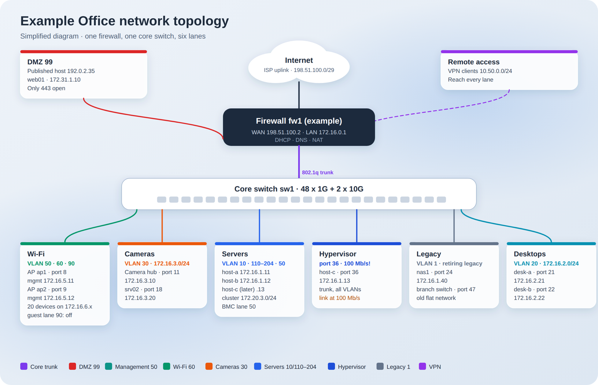
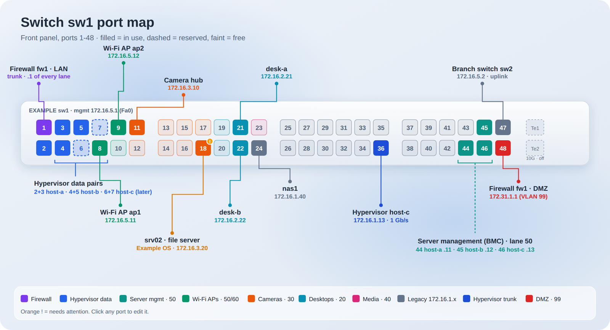
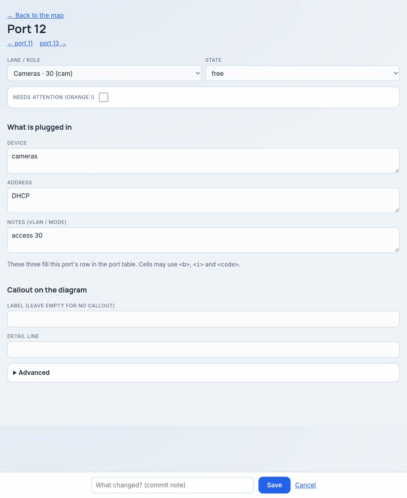
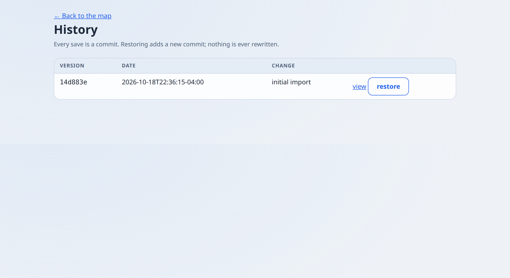
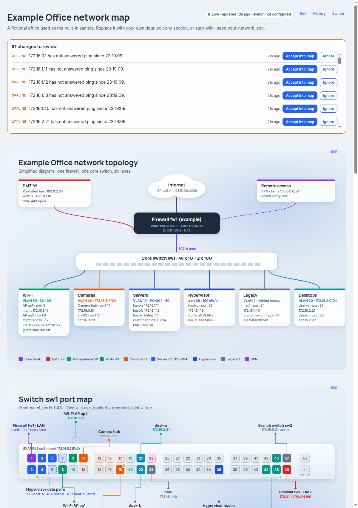

# office-map

**A living, editable network map for a small office.** One JSON file becomes a
topology diagram, a 48-port switch front panel and the reference tables around
them. Click a port to edit it, every save is a git commit you can roll back,
and a read-only switch reader shows where the map and the real switch disagree.

| Click any port to edit it | Every change is in history |
|---|---|
|  |  |

## What you get

- **Two diagrams from one file:** network topology and a switch front panel (odd ports top, even bottom, one colour per VLAN, callouts for what is plugged in).
- **Edit in the browser:** forms per section, plus a compact form behind every port. Drawing and port table stay in sync.
- **History you can trust:** every save is a git commit; view any old version, restore it as a new commit. Nothing is rewritten.
- **Printable:** `/pdf` renders a clean landscape PDF through headless Chrome.
- **Read the real switch (read-only):** connects to a Cisco IOS switch over SSH with a hard allowlist of four `show` commands, compares lanes, link state and descriptions with the map, and lets you pull switch values into the map.
- **Pop-up port editor:** clicking a port opens the same form in a dialog over the map (links still work without JavaScript); saving refreshes the map in place.
- **Live status (read-only, optional):** `-live` pings the addresses in the map and, if the switch reader is configured, reads link state and MAC tables. Ports get status dots, device rows get online/offline pills, the header shows "Live · updated 12s ago". Screen only, never in print or history.
- **Change alerts:** new/moved/gone MACs, link up/down, devices offline too long (or back), switch VLAN differing from the map lane. Each can be accepted into the map (opens the port editor pre-filled) or ignored. Nothing is ever written to the switch.
- **Themeable:** `-theme DIR` links your own CSS after the built-in styles; the new UI is styled through `--om-*` variables.
- **One small binary:** Go standard library plus `golang.org/x/crypto`; no database, no JavaScript framework.

It ships with a fictional "Example Office" (documentation addresses only) so you can try it immediately — the screenshots above are that sample.

> **Keep your real network out of git hosting you don't control.** Run the app with `-seed` pointing at a private `network.json` and keep that data repository private. This repository contains only the app and the sample.

## Build and test

    CGO_ENABLED=0 go build -o office-map .
    go vet ./... && go test ./...

## Run

    ./office-map -listen 127.0.0.1:8090 -data ./data

| Flag         | Default                       | Meaning                                                       |
|--------------|-------------------------------|---------------------------------------------------------------|
| `-listen`    | `127.0.0.1:8090`              | address to serve on                                           |
| `-data`      | `./data`                      | directory holding `network.json` and its `.git`               |
| `-seed`      | (built-in sample)             | `network.json` to import when the data dir is empty           |
| `-git-name`  | `Office Map`                  | committer name for edits                                      |
| `-git-email` | `office-map@localhost`        | committer email for edits                                     |

Extra flags:

| Flag             | Default | Meaning                                                                      |
|------------------|---------|------------------------------------------------------------------------------|
| `-live`          | off     | poll switch + ping devices; enables `/events`, `/live.json`, alerts           |
| `-live-every`    | `30s`   | poll interval                                                                |
| `-offline-after` | `10m`   | alert when a device has not answered ping this long                          |
| `-state`         | `<data>/../state` | directory for `alerts.json` (kept outside the git-tracked data dir) |
| `-theme`         | (none)  | directory of `*.css` (plus `.woff2 .woff .png .svg .jpg`) served at `/theme/` and linked after the built-in styles on every page, print included |

Requires `git` (always) and `google-chrome` or `chromium` in PATH (only for `/pdf`).
There is no login: keep it on localhost or behind your own proxy/auth.

Routes: `/` map, `/edit/<section>` (header, topology, ports, porttable, vlans,
devices, before, hardware, after, power), `/edit/port/<n>` (one port; `te1`/`te2`
for the 10G labels), `/history`, `/history/<hash>` (read-only view), `/switch`,
`/pdf`, `/data.json`, `/live.json`, `/events` (Server-Sent Events), `/alerts`,
`POST /alerts/{id}/ignore|accept`. Add `?fragment=1` to `/` or `/edit/port/N` for just the HTML fragment.

## Live status and alerts

With `-live`, a poller runs every `-live-every`: it runs `show interfaces status` and
`show mac address-table dynamic` through the read-only switch connector (if configured) and
`ping -c1 -W1` against every IPv4 address in the port and devices tables (ranges and DHCP text
are skipped; 16 probes at a time). The page follows `/events`; `/live.json` is the same snapshot.
Port dots: green up, grey down, dark disabled, amber slower than 1000 Mb/s where the map
expects a link, red outline when the switch VLAN differs from the map lane. Alerts are stored in
`alerts.json` under `-state` and de-duplicated; ignored alerts do not come back. Accepting an alert
only pre-fills the port form, so map changes still go through the normal edit and commit flow.

## Theming

`-theme DIR` serves the `*.css` files in DIR (sorted) as `/theme/<name>.css` and links them after the
built-in styles on every page. The pop-up, live badge, dots, pills and alerts read these variables,
declared once in `assets/ui.css` with the app's own colours as defaults: `--om-surface`,
`--om-surface-strong`, `--om-edge`, `--om-shadow`, `--om-blur`, `--om-radius-panel`, `--om-radius-card`,
`--om-radius-chip`, `--om-ink`, `--om-ink-muted`, `--om-accent`, `--om-up`, `--om-slow`, `--om-down`,
`--om-unknown`, `--om-disabled`, `--om-font-head`, `--om-font-body`. A theme only has to remap them.
Nothing from the theme directory is embedded or committed.

## Data and history

`network.json` is the single source of truth. On first run the data dir is
created, seeded (from `-seed`, else the built-in sample) and `git init`ed. Each
save validates, writes atomically (temp file + rename), regenerates the page and
commits with the message `<section>: <note>`. "Restore" in History writes the
old version as a *new* commit; history is never rewritten. Back up the data dir
(it is a normal git repo). Keep your real data out of any public repository:
the data dir is git-ignored here.

## Clickable ports

Every port in the switch diagram is a link to `/edit/port/N`: one compact form
for lane, state, attention flag, device, address, notes and the callout. Saving
also updates (or creates) the matching row in the port table, so the drawing and
the table always agree.

## Optional: read-only switch comparison

`/switch` compares the map with a live Cisco IOS 15.x switch and lets you copy
chosen values from the switch into the map. It is strictly read-only towards the
switch: only `terminal length 0`, `show interfaces status`, `show vlan brief`,
`show interfaces trunk` and `show mac address-table dynamic` can ever be sent
(enforced in code and unit-tested).

| Flag                    | Meaning                                                           |
|-------------------------|-------------------------------------------------------------------|
| `-switch-host`          | `host` or `host:port` of the switch (enables the feature)         |
| `-switch-user`          | SSH user                                                          |
| `-switch-key`           | path to the private key                                           |
| `-switch-known-hosts`   | OpenSSH `known_hosts` file; host keys are strictly verified       |
| `-switch-hostkey-alias` | name to look up in known_hosts instead of the host (optional)     |
| `-switch-jump`          | `user@host` of a hop to go through (same key, optional)           |

Host keys are never auto-accepted. The connector enables the legacy algorithms
IOS 15.2 needs (`ssh-rsa` host key, RSA/SHA-1 public-key signatures,
`diffie-hellman-group14-sha1`); use it only on a trusted management network.

## Testing against the original generator (optional)

The renderer reproduces the output of an earlier Python generator. If you have
it, point `OFFICEMAP_REAL_DIR` at a directory holding `network.json`, `build.py`
and `topo.py` and run `go test -run TestMatchesPython -v`; without the variable
the test is skipped.

## systemd --user unit

`~/.config/systemd/user/office-map.service`:

    [Unit]
    Description=Office network map

    [Service]
    ExecStart=%h/office-map/office-map -listen 127.0.0.1:8090 -data %h/office-map/data
    Restart=on-failure

    [Install]
    WantedBy=default.target

Then `systemctl --user daemon-reload && systemctl --user enable --now office-map`
(and `loginctl enable-linger $USER` to keep it running when logged out).

## License

MIT, see `LICENSE`.
